<p align="center">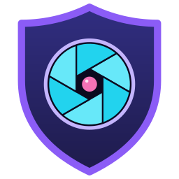</p>

<h1 align="center">AegisLens 🛡️</h1>

<p align="center">
  <b>A defensive security workbench for log monitoring, Windows host detection, static file analysis and link
  checking, built with Java 26 and JavaFX 26. Works fully offline.</b>
</p>

<p align="center">
  <a href="https://github.com/sriman676/AegisLens/actions/workflows/ci.yml"></a>
  
  
  
  
  
  
  
  
</p>

<p align="center">
  <a href="#-how-it-works">How it works</a> •
  <a href="#-quick-start">Quick start</a> •
  <a href="#-see-it-work-in-2-minutes">Demo</a> •
  <a href="#-reading-windows-sysmon-logs">Sysmon</a> •
  <a href="#-detection-rules">Rules</a> •
  <a href="#-security-and-safety">Security</a> •
  <a href="#-faq-and-troubleshooting">FAQ</a>
</p>

---

AegisLens is one desktop program (plus an optional headless service) that turns raw security data into **scored,
explained findings**. It watches SSH and web-server logs live, reads Windows Security and **Sysmon** event exports,
analyses files without ever running them, checks links for phishing tricks, runs harmless demo programs in a sandbox,
and stores everything in SQLite with reports, full-text search and exports.

> [!IMPORTANT]
> **Defensive only.** AegisLens detects and reports. It never exploits, never executes the files it analyses, and never
> changes a firewall: it writes firewall commands for you to review.

<p align="center">
  <a href="docs/media/aegislens-launch.mp4">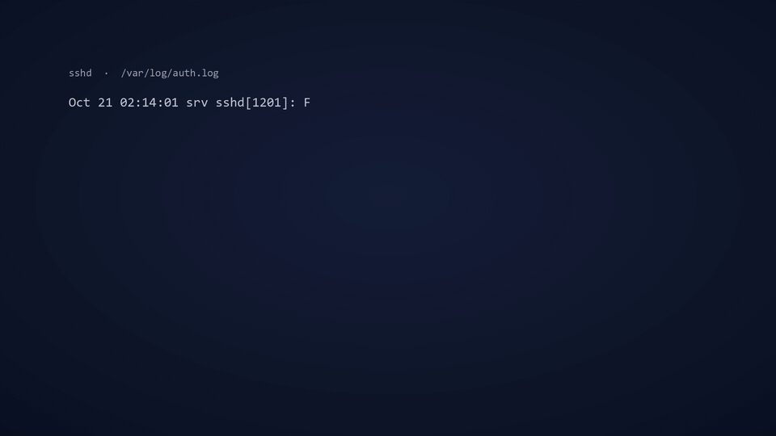</a>
  <br>
  <sub>🎬 <a href="docs/media/aegislens-launch.mp4"><b>Watch the full video with sound</b></a> (MP4, 1080p, 22 s)</sub>
</p>

## ✨ Highlights

- 🔴 **Live detection**: brute force, password spraying, path scans, SQL injection and threat-list hits appear on screen within half a second.
- 🪟 **Windows host visibility**: Sysmon exports reveal hidden PowerShell, misused system tools, malicious documents and autostart persistence. Tested on real Sysmon data with no false alarms.
- 🧬 **Safe file analysis**: PE/ELF parsing, entropy and risky imports, all without executing a single byte.
- 🤖 **Explained findings**: plain-language explanations from Claude, Gemini, a local model, or built-in offline text.
- 🗄️ **Real database work**: views, triggers, FTS5 search, GROUP BY/HAVING reports with query plans, and a read-only SQL console.
- 📴 **Offline first**: everything works without a network; threat feeds are cached and refreshed daily.

## 🧭 How it works

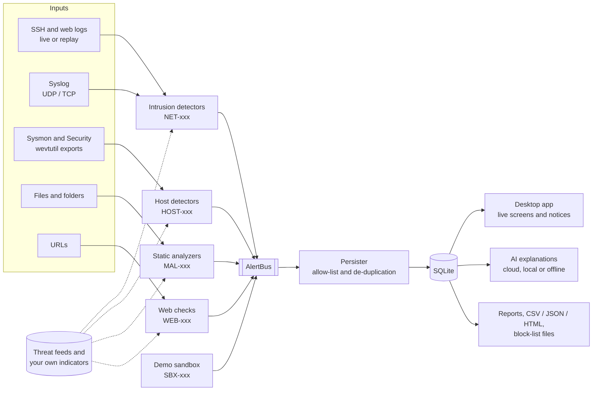

Every input is parsed as untrusted data and turned into **findings**: a rule, a target, a score from 0 to 100 and the
evidence behind it. Detectors publish findings to a hand-written producer/consumer **AlertBus**. One persister thread
drops allow-listed and repeated findings, saves the rest in SQLite in batches, and tells the screens, which refresh
themselves. Nothing analysed is ever executed; only the sandbox may start processes, and only the project's own demo
programs.

## 🚀 Features

| | Area | What it does |
|---|---|---|
| 🔐 | **Intrusion** | Tails SSH (`auth.log`/`secure`) and web access logs live, receives syslog (UDP/TCP) and replays any log. Detects brute force (escalated when a login then succeeds), password spraying, path scans, odd-hour logins, request-rate anomalies (z-score), SQL injection, attack-tool user agents and threat-list addresses. |
| 🪟 | **Windows host (Sysmon)** | Reads `wevtutil` exports of Sysmon and flags suspicious PowerShell, misused Windows tools (certutil, mshta, rundll32, regsvr32...), Office or browsers starting shells, programs run from user folders, connections and DNS lookups to listed or look-alike destinations, and autostart persistence (Startup folder, Run keys, services). |
| 🧬 | **Malware (static)** | Hashes (MD5/SHA-256), entropy, PE and ELF header parsing (imports, sections, odd structure), embedded URLs/IPs, dropper tricks in scripts, known-bad hashes, optional VirusTotal hash lookup, a quarantine vault and a watched download folder. |
| 🌐 | **Web** | Look-alike and deceptive domains (punycode, confusable letters, edit distance), raw-IP hosts, injection patterns and threat-list domains; with your consent, one fetch through an SSRF guard for missing security headers and suspicious HTML. |
| 📦 | **Sandbox** | Runs the project's own harmless demo programs under time, output and file limits and turns their behaviour into findings. Unknown files run only in a locked-down Docker/Podman container, off by default and meant for a disposable VM. |
| 🤖 | **AI explanations** | Plain-language explanation of any finding: Claude or Gemini (your own key), a local model (e.g. Ollama) or built-in offline text. Prompts carry sanitised metadata only; IPs and user names are replaced before anything leaves the machine. |
| 🗄️ | **Database and reports** | SQLite through JDBC: views, triggers, full-text search (FTS5), GROUP BY/HAVING and subquery reports with their query plans, a read-only SQL console, CSV/JSON export and import, an HTML report, block-list and firewall command files, backups and retention. |
| 🛰️ | **Threat intelligence** | Spamhaus DROP and abuse.ch Feodo feeds (daily, conditional GET, offline afterwards), plus your own IPs, ranges, hashes, domains and feeds. |
| 🖥️ | **Desktop app** | Dashboard with live cards and charts, screens that update by themselves, a corner notice for new CRITICAL findings, dark/light/high-contrast designs, custom accent colour, text size and branding, an AWT analyst console and keyboard shortcuts. |
| ⚙️ | **Headless service** | `--headless` for servers: systemd unit, Windows logon task, configuration check and exit codes. |

### 🖼️ Screenshots

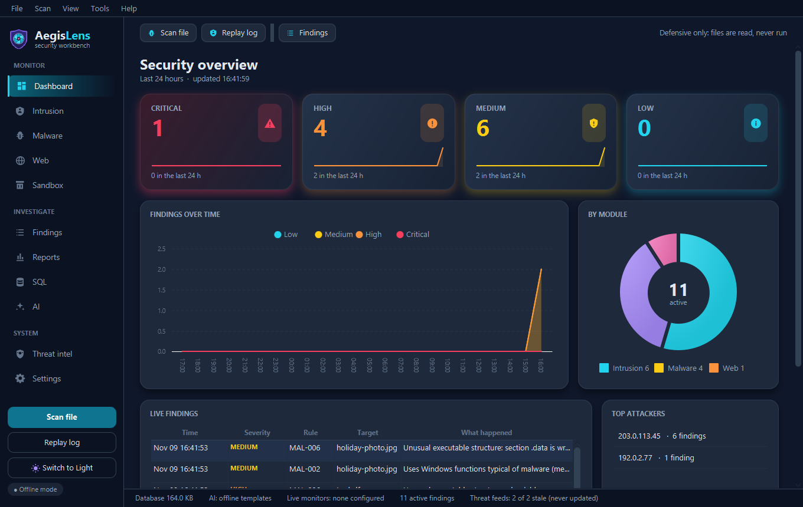

<p align="center">
  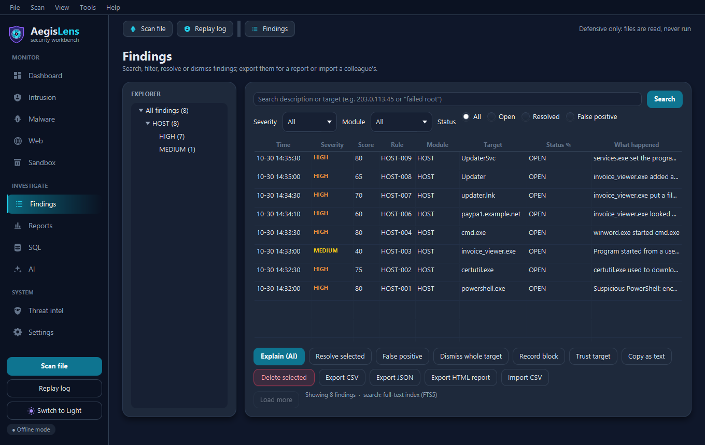
  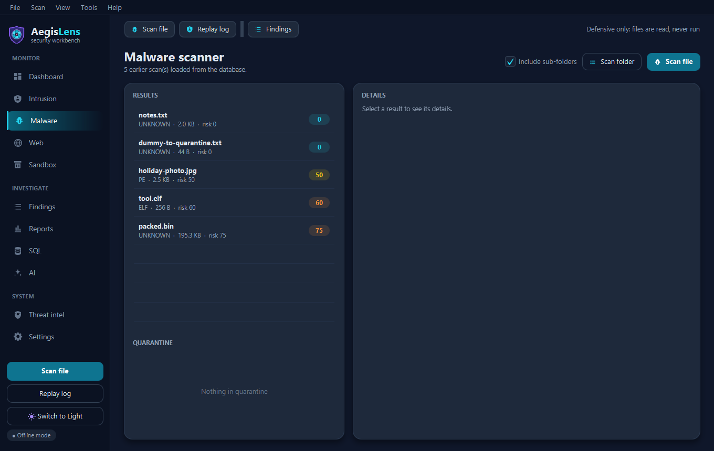
</p>

<details>
<summary><b>More screens</b> (click to open)</summary>

| | |
|:---:|:---:|
| 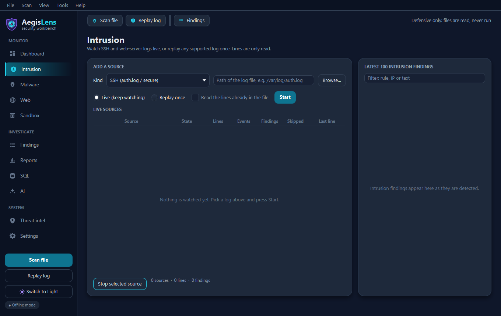 **Intrusion**: live log monitors and replay | 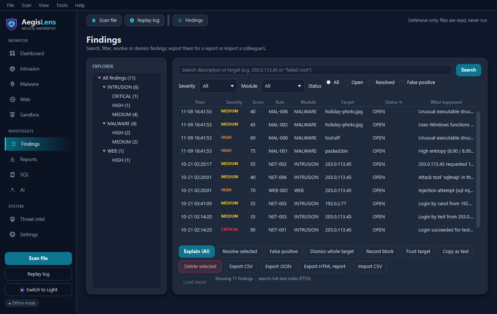 **Findings**: search, filters, explorer and bulk actions |
| 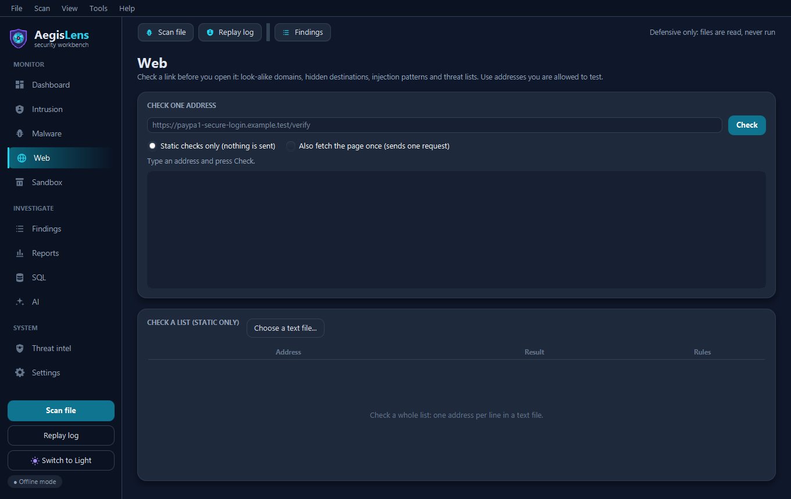 **Web**: link checks and the consented page fetch | 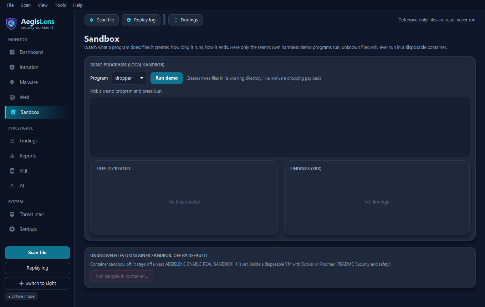 **Sandbox**: demo programs under limits |
| 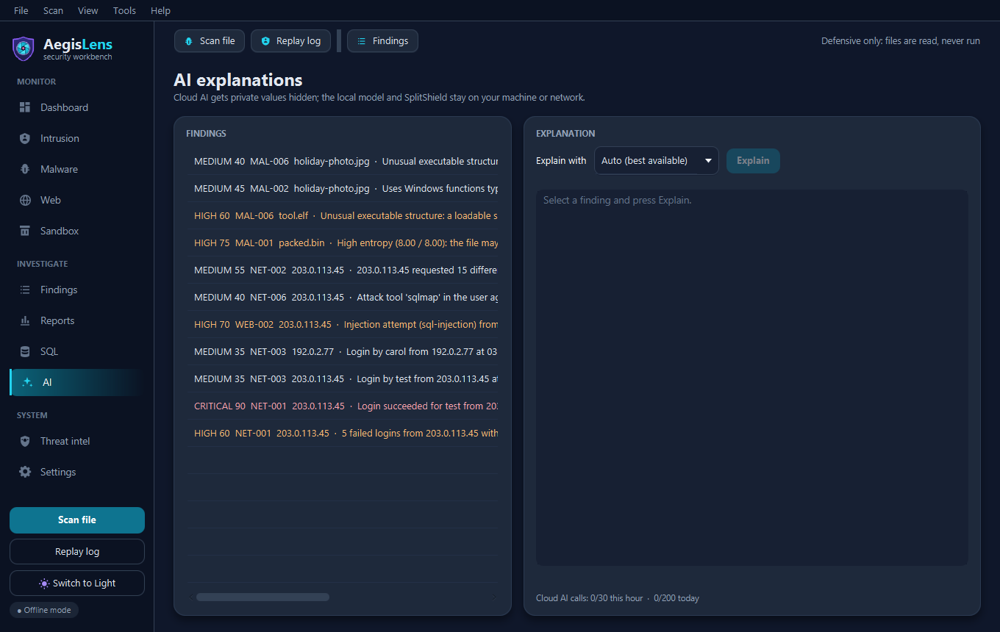 **AI**: explanations, cloud, local or offline | 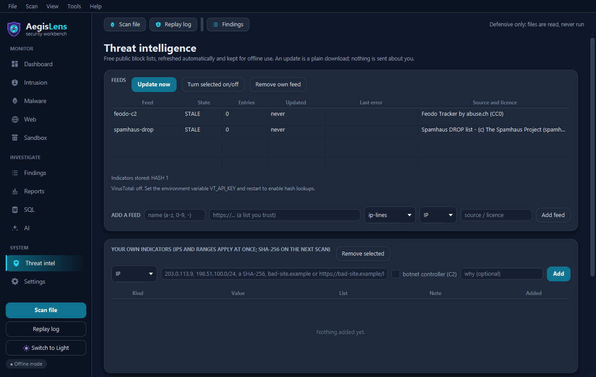 **Threat intel**: feeds, own indicators, blocks |
| 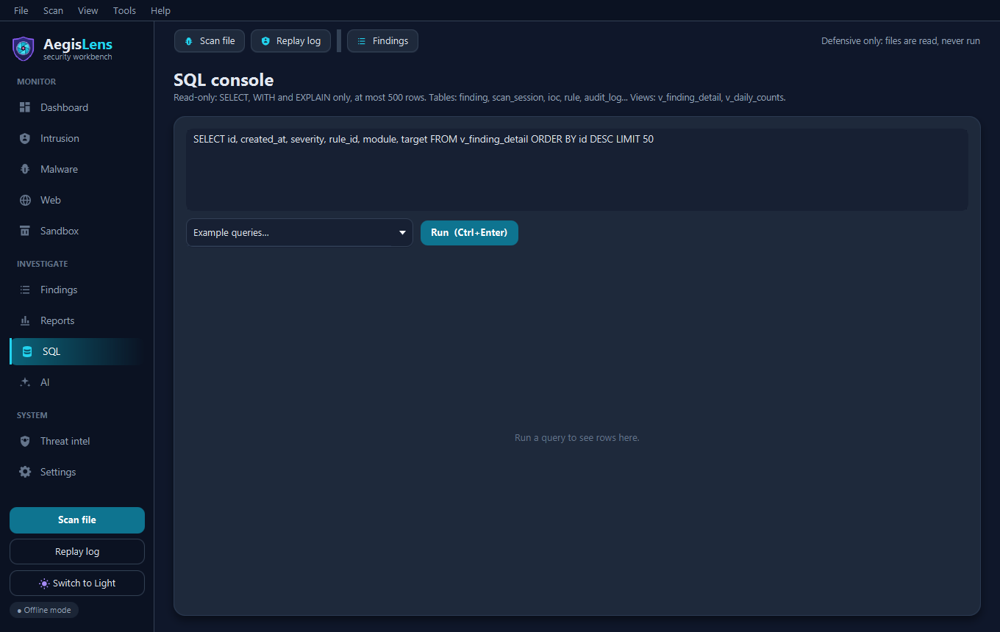 **SQL**: read-only console with examples | 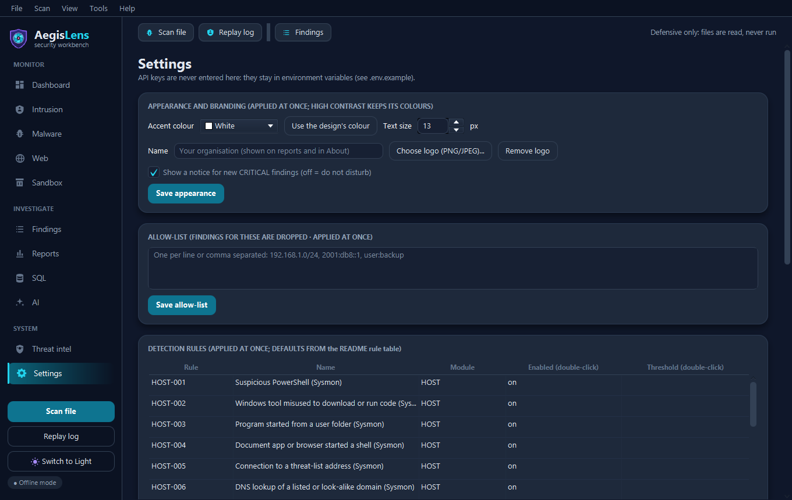 **Settings**: rules, allow-list, retention, look |
| 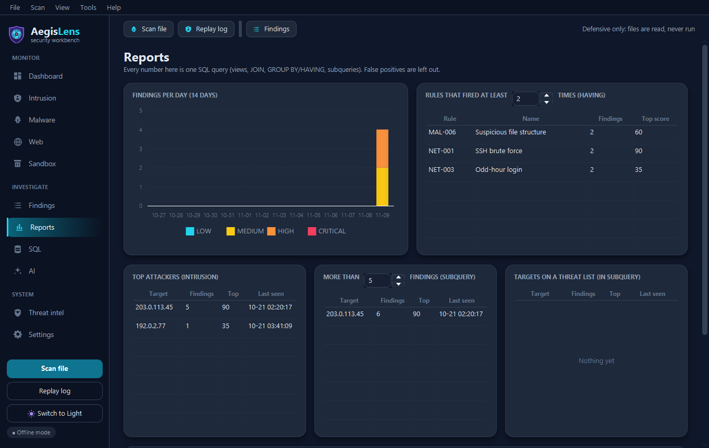 **Reports**: per day, HAVING, subqueries, query plans | 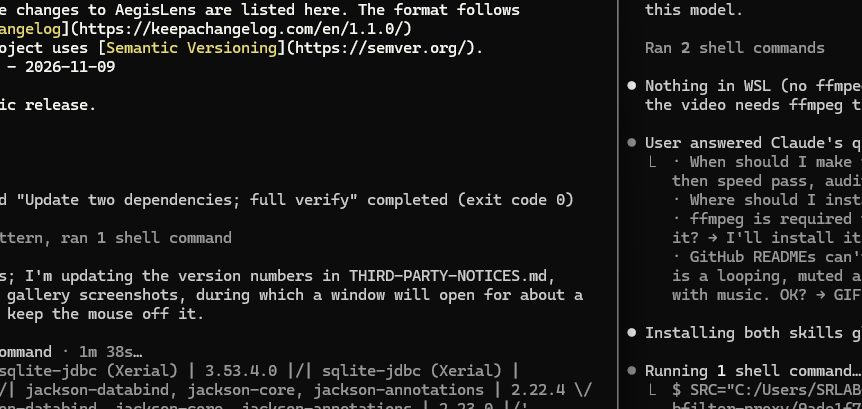 **Analyst console** (AWT) |

</details>

## ⚡ Quick start

**Requirements:** JDK 26 and Maven 3.9+ on Windows, Linux or macOS.

```bash
git clone https://github.com/sriman676/AegisLens.git && cd AegisLens
mvn clean verify                         # build, 330 tests, coverage check
mvn javafx:run                           # start the desktop app during development
mvn package                              # builds target/aegislens-1.0.0.jar for this operating system
java -jar target/aegislens-1.0.0.jar     # desktop app
java -jar target/aegislens-1.0.0.jar --headless --config aegislens.properties   # server mode
```

💾 **Got a ready-made `aegislens-1.0.0.jar` (Windows build)?** Run it directly with `java -jar aegislens-1.0.0.jar`;
only JDK 26 is needed, no Maven.

> [!NOTE]
> The JAR contains the JavaFX native libraries of the OS it was built on, so build it once per OS.
> `deploy/package-app-image.sh` (or `.cmd`) builds a self-contained folder with its own Java runtime.

## 🎬 See it work in 2 minutes

Everything below uses the synthetic files in `sample-data/` (reserved documentation addresses only).

1. **Replay an attack.** Click **Replay log** in the sidebar and pick `sample-data/auth.log` (the log type is
   recognised from the file name and the replay starts at once). Within a second the dashboard fills up: `203.0.113.45` fails to log in five times in a minute (**NET-001**, HIGH),
   then succeeds (**NET-001** escalated to 90, **CRITICAL**). A notice pops up in the corner, wherever you are in the app.
2. **Ask why it matters.** Open **AI**, select the CRITICAL finding and press **Explain**. Without any key you get the
   built-in explanation: *what happened* (a successful login right after a burst of failures), *why it matters* (the
   attacker may be inside) and *how to fix it* (block the address, switch to SSH keys, check the account).
3. **Respond.** In **Findings**, select it and press **Record block**. Then **Threat intel > Export blocklist + firewall
   commands...** writes `blocklist.txt`, `iptables.sh`, `nftables.nft`, `ufw.sh` and `windows-netsh.cmd` for you to
   review. AegisLens itself never touches your firewall.
4. **Go further.** Replay `sample-data/access.log` for a path scan, `sqlmap` and SQL injection; replay
   `sample-data/sysmon-sample.xml` for the Windows host rules; paste links from `sample-data/urls.txt` into **Web**;
   open **Reports** to see the SQL behind every number.

## 🪟 Reading Windows Sysmon logs

Reading the Sysmon log needs administrator rights, and AegisLens never starts processes outside its sandbox. So export
the events as administrator and let AegisLens read the file:

```bat
wevtutil qe Microsoft-Windows-Sysmon/Operational /c:5000 /rd:true /f:xml > C:\Users\Public\sysmon.xml
```

Then use **Replay log** (a file name containing "sysmon" is recognised automatically).

- 🔁 **Regular checks:** set `monitor.sysmon.folder` and let Task Scheduler drop new exports there. Each new file is read
  once, and events already read from an earlier export of the same computer are skipped.
- 🔑 **Windows Security events** (4624, 4625, 4740) work the same way:
  `wevtutil qe Security "/q:*[System[(EventID=4624 or EventID=4625 or EventID=4740)]]" /f:xml > security.xml`

> [!WARNING]
> Exports contain user names and command lines: keep them private and delete them when you are done.

## ⚙️ Configuration

Settings live in `~/.aegislens/aegislens.properties` (example: `deploy/aegislens.properties.example`). Most of them can
also be changed in the app under **Settings**, where rules are switched on and off live. Any option can be given as
`--key=value` or as an environment variable `AEGISLENS_<KEY>` (dots become underscores).

| Option | Meaning |
|---|---|
| `monitor.ssh.files`, `monitor.web.files` | logs to watch live (comma-separated) |
| `monitor.sysmon.folder` | folder for Sysmon exports, read as they arrive |
| `monitor.scan.folders` | folders whose new files are scanned (for example Downloads) |
| `syslog.udp.port`, `syslog.tcp.port`, `syslog.allow` | receive syslog from listed senders (-1 = off) |
| `oddhour.start`, `oddhour.end`, `oddhour.zone` | working hours for the odd-hour login rule |
| `feeds.enabled` | `false` = never download threat feeds |
| `local.llm.url`, `local.llm.model` | a local AI model for explanations |
| `data.dir` | where the database, logs, backups and quarantine live |

🔑 API keys are read **only** from environment variables and are never stored: `CLAUDE_API_KEY`, `GEMINI_API_KEY`,
`VT_API_KEY`, `LOCAL_LLM_API_KEY`, `SPLITSHIELD_TOKEN`, `AEGISLENS_WEBHOOK_URL` (see `.env.example`).
`--check-config` validates a configuration without starting it (exit code 0 = OK, 2 = problems).

### 🧰 Running as a service

<details>
<summary><b>🐧 Linux (systemd)</b></summary>

Copy the JAR to `/opt/aegislens/aegislens.jar` and the example properties to `/etc/aegislens/aegislens.properties`,
create an `aegislens` system user owning `/var/lib/aegislens`, then run:

```bash
sudo cp deploy/aegislens.service /etc/systemd/system/
sudo systemctl enable --now aegislens
journalctl -u aegislens -f
```

Keys go in `/etc/aegislens/aegislens.env` (mode 600). `systemctl stop` shuts down cleanly: log positions are saved and
the database is closed.
</details>

<details>
<summary><b>🪟 Windows (Task Scheduler)</b></summary>

```bat
deploy\windows\install-task.cmd "C:\path\to\aegislens-1.0.0.jar"
```

This starts AegisLens at every logon without admin rights; `deploy\windows\uninstall-task.cmd` removes it.
</details>

Exit codes in headless mode: `0` stopped normally, `1` unexpected error, `2` configuration problem, `3` already running
on this data folder.

## 🎯 Detection rules

Every finding has a score from 0 to 100, and the severity follows from it:

| 🟢 LOW | 🟡 MEDIUM | 🟠 HIGH | 🔴 CRITICAL |
|:---:|:---:|:---:|:---:|
| 0-29 | 30-59 | 60-84 | 85-100 |

Scores are triage hints, not verdicts. Thresholds are named constants, and the rule table can be edited in Settings.

<details open>
<summary><b>All rules</b></summary>

| Rules | What they look for | Score |
|---|---|---|
| NET-001 | 5+ failed logins from one IP in 60 s; a success right after | 60-85; 90 |
| NET-002 | 15+ distinct paths answered 403/404 for one IP in 60 s | 55-80 |
| NET-003 | successful login outside working hours | 35 |
| NET-004 | request rate z-score >= 3 against the IP's own history | 45-80 |
| NET-005 | source IP on a threat list (botnet C2 lists score higher) | 75 / 90 |
| NET-006 | attack-tool user agent (sqlmap, nikto, nmap...) | 40 / 55 |
| NET-007 | 5+ user names tried from one IP in 60 s (spraying) | 65-85 |
| MAL-001 | entropy >= 7.2 bits/byte (packed or encrypted) | 50-75 |
| MAL-002 | suspicious Windows APIs; dropper techniques in scripts | 35-85 |
| MAL-003 | embedded URLs and IP addresses | 15-35 |
| MAL-004 | SHA-256 on a known-bad list | 100 |
| MAL-005 | VirusTotal engines flag the hash (opt-in) | 50-90 |
| MAL-006 | odd PE/ELF structure (W+X sections, entry outside code, UPX...) | 40-70 |
| WEB-001 | phishing signs: look-alike domain, raw IP, `@`, punycode, odd TLD | 40-90 |
| WEB-002 | SQL injection / XSS pattern in a URL or web log | 70 |
| WEB-003 | missing security headers (HSTS, CSP, X-Frame-Options, nosniff) | 20-40 |
| WEB-004 | domain or URL on a threat list | 90 |
| WEB-005 | suspicious HTML (foreign form target, hidden iframe, obfuscated script) | 30-80 |
| HOST-001 | PowerShell with an encoded command or 2+ hiding/download signs | 70-90 |
| HOST-002 | Windows tool misused to download or run code | 75 |
| HOST-003 | program started from Temp, Downloads, Public or AppData\Roaming | 40 |
| HOST-004 | browser (60) or Office/PDF reader (80) starting a shell; browser extension helpers excluded | 60 / 80 |
| HOST-005 | connection to a threat-list address | 85 |
| HOST-006 | DNS lookup of a look-alike (60) or listed (85) domain | 60 / 85 |
| HOST-007 | file created in a Startup folder | 70 |
| HOST-008 | value set under a Run / RunOnce key | 65 |
| HOST-009 | service program (ImagePath) set; +20 in a user folder | 60-80 |
| SBX-001 to 005 | sandbox: created files, timeout, output flood, error exit, out of memory | 25-60 |
| MON-001 | a watched log went silent | - |

</details>

♻️ Repeated hits for the same rule and target are folded into one finding with a count (10-minute window), and an
allow-list drops findings for trusted addresses and users. Every rule has an offline explanation.

## 🔒 Security and safety

- 🚫 **Analysed input is never executed.** The static modules only read bytes; CI fails if process-starting or
  class-loading calls appear outside the `sandbox` package.
- 📦 **Sandbox:** the local sandbox runs only the project's own demo programs. The container sandbox runs a file only
  with `AEGISLENS_ENABLE_REAL_SANDBOX=1`, with no network, a read-only copy of the sample, dropped capabilities, a
  non-root user and memory/process/time limits, and it asks for confirmation first. Use it only inside a disposable VM.
- 🧹 **Untrusted text everywhere:** log lines are capped and cleaned, regexes avoid catastrophic backtracking, XML parsing
  refuses DOCTYPE and external entities (XXE), every size is limited, and untrusted text is shown only as plain text
  (control and bidi-override characters removed).
- 🌐 **Network:** HTTPS with certificate checks always on, self-signed services only through certificate pinning, no
  automatic redirects, and capped response sizes. The page fetch resolves the host once, refuses private, loopback and
  link-local addresses, and connects to exactly that address (no DNS-rebinding window).
- 🕵️ **Privacy:** cloud AI receives sanitised metadata with IPs and user names replaced, raw log lines never leave the
  machine, and budgets limit cloud calls per hour and per day.
- 🗄️ **Database:** PreparedStatement only (CI checks for string-built SQL), one writer connection and a read-only reader,
  a single-instance lock, an integrity check and backups.

Found a vulnerability? Please report it privately as described in [SECURITY.md](SECURITY.md).

## 📊 Quality

| Check | Result |
|---|---|
| ✅ Automated tests | 330 JUnit tests, green on Windows 11 and Ubuntu |
| 📈 Coverage (JaCoCo, build fails below 70 %) | core 95 %, db 94 %, malware 94 %, web 90 %, intrusion 88 %, ai 87 % |
| 🎲 Fuzzing | 21 parsers and detectors fed random input, no crash (`mvn test -Dtest=FuzzTest -Dfuzz.seconds=60`) |
| 🎯 Labelled evaluation | 152 events: recall 1.00, precision 0.91 |
| 🪟 Real Sysmon data | 7 974 events from a Windows 11 workstation: both harmless attack simulations detected, no false alarms (two found and fixed during the check) |
| ⚡ Load | 85 000 log lines per second through the whole pipeline; runs in a 128 MB heap |
| ⏱️ Soak | 60 minutes of live input: heap 10 MB and 14 threads from start to end |
| 🗄️ Database | dashboard reload 0.26 s and reports 0.2 s on 1 million findings |

> [!NOTE]
> Not verified yet: macOS (the CI workflow builds there), a full container-sandbox run, and live cloud AI / VirusTotal
> calls (tested against local fake servers).

## ❓ FAQ and troubleshooting

<details>
<summary><b>The app does not open a window, or JavaFX reports an error at start</b></summary>

The JAR only contains JavaFX for the operating system it was built on: build it on the same OS with `mvn package`.
On a machine without a display (a server), AegisLens switches to headless mode by itself.
</details>

<details>
<summary><b>"AegisLens is already running"</b> or exit code 3</summary>

Only one AegisLens may use a data folder at a time, so the database is never written twice. Close the other window or
service, or start the second one with `--data.dir=<another folder>`.
</details>

<details>
<summary><b>Does it need the internet?</b></summary>

No. Everything works offline: explanations fall back to the built-in text and the last downloaded threat feeds stay in
use. Set `feeds.enabled=false` to never download feeds; a proxy can be set under Settings.
</details>

<details>
<summary><b>Cloud AI is not used even though I have a key</b></summary>

Keys are read from environment variables when AegisLens starts: set `CLAUDE_API_KEY` or `GEMINI_API_KEY`, then restart
it. The AI screen shows which provider answered and why it fell back, and the hourly/daily budget.
</details>

<details>
<summary><b>wevtutil says "Access is denied", or the export file is empty</b></summary>

Run the command in a Command Prompt opened with **Run as administrator**. If that prompt belongs to another Windows
account, `%USERPROFILE%` points to that account's folder: write to a shared path such as `C:\Users\Public\sysmon.xml`.
</details>

<details>
<summary><b>Where is my data, and how do I start fresh?</b></summary>

In `~/.aegislens` (`C:\Users\<you>\.aegislens` on Windows): the database, logs, backups and the quarantine vault.
Close AegisLens and delete the folder to start fresh, or point `data.dir` somewhere else.
</details>

<details>
<summary><b>A rule is too noisy for my environment</b></summary>

Switch it off or change its threshold in **Settings > Detection rules** (applied at once), add trusted addresses and
users to the allow-list, or mark a finding as a false positive. A synthetic example in an issue helps improve the rule
for everyone.
</details>

## 🗂️ Project layout

```
src/main/java/com/aegislens/
  core/        shared contracts: Finding, Severity, Analyzer<T>, Detector<T>, AlertBus, exceptions
  intrusion/   log parsers, Sysmon reader, detectors, live tailing and syslog
  malware/     hashes, entropy, PE/ELF parsers, file scanner, quarantine, folder watcher
  web/         URL, look-alike, HTML and header checks with the SSRF guard
  sandbox/     local demo sandbox and container sandbox
  ai/          LLM providers, sanitiser, redactor, prompt builder, offline templates
  intel/       threat feeds and VirusTotal
  db/          SQLite database, migrations, repositories, reports, SQL console
  app/         wiring: ScanCoordinator, persister thread, config, headless mode
  response/    block-list and firewall command files, HTML report
  net/         shared HTTP client, retries, size limits, proxy, connectivity
  ui/          JavaFX screens, presenters, AWT analyst console
  util/        IP ranges, injection patterns, small helpers
src/main/resources/   schema.sql, rules, feeds, icons, stylesheets, explanation templates
src/test/java/        JUnit tests (fake PE/ELF bytes and fake servers, no real malware)
sample-data/          synthetic logs, URLs, labelled events and a Sysmon export
deploy/               systemd unit, Windows logon task, app-image packaging, example settings
```

## 🤝 Contributing

Bug reports, false-alarm reports, new detection ideas and pull requests are welcome. Please read
[CONTRIBUTING.md](CONTRIBUTING.md) for the build, the code rules and how to add a rule, and [CHANGELOG.md](CHANGELOG.md)
for what changed in each version.

## 📄 License

AegisLens is released under the [MIT License](LICENSE). Third-party libraries, data sources and their terms are listed
in [THIRD-PARTY-NOTICES.md](THIRD-PARTY-NOTICES.md).

<p align="center">⚠️ Analyse only systems and files you own or are allowed to test. ⚠️</p>
